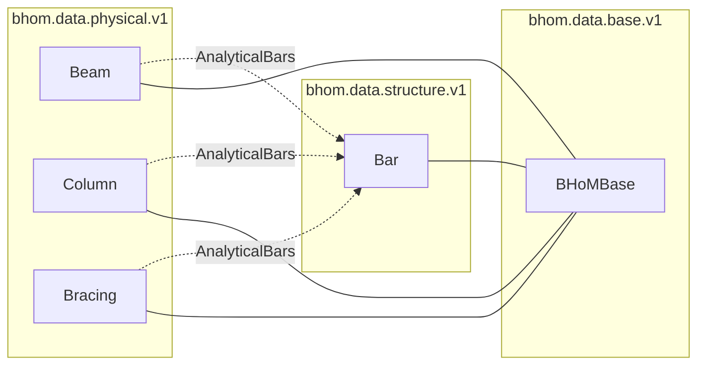

# Proposal: BHoM Wave 1 Buf registration

**Status:** Draft for review (July 2026)  
**Repo:** `motif-proto`  
**Aligns with:** BHoM Buf registration exec summary (Buro Happold / platform)  
**Related:** `bhom-ecs-component-design.md` (motif-ecs-mapper / motif_bhom)

---

## Summary

Register BHoM-owned **Wave 1 framing** types in Motif’s Buf module under partner packages (`bhom.data.`*), not under `motif.*`. Motif hosts the schemas initially; long-term ownership remains BHoM.

Wave 1 delivers:


| Buf type                        | Component ID | BHoM source                                 |
| ------------------------------- | ------------ | ------------------------------------------- |
| `bhom.data.base.v1.BHoMBase`    | 118          | `BH.oM.Base.BHoMObject` (+ type breadcrumb) |
| `bhom.data.structure.v1.Bar`    | 119          | `BH.oM.Structure.Elements.Bar`              |
| `bhom.data.physical.v1.Beam`    | 120          | `BH.oM.Physical.Elements.Beam`              |
| `bhom.data.physical.v1.Column`  | 121          | `BH.oM.Physical.Elements.Column`            |
| `bhom.data.physical.v1.Bracing` | 122          | `BH.oM.Physical.Elements.Bracing`           |


Profiles / uniform framing sections are **embedded value types** (not components).

---

## Goals

1. Persist and query BHoM-shaped 1D framing (physical authoring + structure analysis) on Motif entities.
2. Keep BHoM’s Physical vs Structure split — do **not** collapse Beam/Column/Bracing/Bar into one Motif type or a `BarType` enum.
3. Establish the partner package pattern for future 3p registrations.
4. Adapter-flatten into Motif core / Motif FDE where those homes already exist (Level, Wall, Room, grids, geometry primitives).

## Non-goals (this wave)

- Floor / Roof (Wave 2)
- Structure Node / Panel / Edge (Wave 3)
- Environment fragments (Wave 4)
- Re-registering Architecture Room, Spatial Level/Grid, or Geometry Line/Point under `bhom.`*
- Full `BHoMObject` bag (Guid, Tags, Fragments, CustomData) — only Name + breadcrumb in Wave 1
- Trait markers (`FramingElement`, `Element1D`) as Buf components — derive on spawn

---

## Package layout


|                  |                              |
| ---------------- | ---------------------------- |
| Motif-proto path | `proto/3p/bhom/<domain>/v1/` |
| Protobuf package | `bhom.data.<domain>.v1`      |
| Import path      | `3p/bhom/<domain>/v1/…`      |


| Domain    | Package                  | Path                          | Wave 1                                           |
| --------- | ------------------------ | ----------------------------- | ------------------------------------------------ |
| Base      | `bhom.data.base.v1`      | `proto/3p/bhom/base/v1/`      | `BHoMBase`                                       |
| Physical  | `bhom.data.physical.v1`  | `proto/3p/bhom/physical/v1/`  | Beam, Column, Bracing + Profile / FramingSection |
| Structure | `bhom.data.structure.v1` | `proto/3p/bhom/structure/v1/` | Bar                                              |


**Buf note:** `PACKAGE_DIRECTORY_MATCH` expects `bhom/data/...` for package `bhom.data...`. Partner trees under `proto/3p/` intentionally diverge; `buf.yaml` has `ignore_only` for `PACKAGE_DIRECTORY_MATCH` on `proto/3p`.

Future partners follow the same pattern: `proto/3p/<partner>/<domain>/v1/` → `<partner>.data.<domain>.v1`.

---

## Three lanes (do not conflate)


| Lane       | Buf home                                     | Examples                                           |
| ---------- | -------------------------------------------- | -------------------------------------------------- |
| Motif core | `motif.data.model.v1`, `geometry`, `view`, … | Lines, walls, levels, views                        |
| Motif FDE  | `motif.data.fde.*.v1`                        | Rooms / footprints / portals; site; georef; datums |
| BHoM-owned | `bhom.data.<domain>.v1`                      | Wave 1 framing; later Floor/Roof, FEM, env         |


Register under `bhom.data.`* only when BHoM-shaped persistence / Engine queries are needed. Otherwise adapter into Motif.




---

## ECS composition

Motif entities compose **separate components**. Domain messages do not nest `BHoMBase`.

```text
Entity (physical beam)
  ├── BHoMBase   // breadcrumb + Name
  └── Beam       // start/end + FramingSection

Entity (analytical bar)
  ├── BHoMBase
  └── Bar        // start/end + orientation + Profile
```

This lets Motif-adapted entities carry `BHoMBase` without a Beam/Bar marker, and supports queries like “all BHoM-backed entities” via `BHoMBase` alone.

---

## Type design

### `BHoMBase` (component)


| Field                 | Purpose                                                                                             |
| --------------------- | --------------------------------------------------------------------------------------------------- |
| `bhom_type_full_name` | Upstream oM full name (JSON `_t` style), e.g. `BH.oM.Physical.Elements.Beam` — **not** the Buf path |
| `bhom_assembly`       | Optional disambiguator (e.g. `Physical_oM`)                                                         |
| `name`                | `BHoMObject.Name`                                                                                   |


### Physical framing (components)

`Beam` / `Column` / `Bracing` share the `IFramingElement` shape:

- **Location (Wave 1):** `start_point` / `end_point` as Motif `Point3` (straight members only; BHoM `Location` is `ICurve`)
- **Section:** embedded `FramingSection` (readable name for BHoM `ConstantFramingProperty`)
- **Linkage:** `analytical_bar_ids` soft links toward Structure `Bar` (convention TBD)

`FramingSection` (embed, not a component):

- `profile` — cross-section
- `orientation_angle` — radians; roll about member axis (lives on the property in BHoM Physical, not on the element)

### `Bar` (component)

Analysis-layer 1D member. Orientation is on the Bar itself (Structure_oM), with an embedded `Profile` for Wave 1 (full `ISectionProperty` later). Nodes stay embedded as points until Wave 3.

### `Profile` (embed, not a component)

Mirrors `BH.oM.Spatial.ShapeProfiles.IProfile`, hosted under **physical** (no `bhom.data.spatial` package).


| Field              | Role                                                                          |
| ------------------ | ----------------------------------------------------------------------------- |
| `shape`            | BHoM `ShapeType` numeric identity                                             |
| `edges`            | Shared geometric truth (`ICurve` → Motif `Curve2`); free-form uses edges only |
| `name`             | Optional display name                                                         |
| `oneof definition` | Parametric dims for concrete profiles; **unset** = free-form                  |


`ShapeType` keeps Rectangle = 0 (matches BHoM; Buf `_UNSPECIFIED` rule suppressed). Geometry is Motif-embedded — never spawn Line/Point entities for section edges or member axes.

---

## Files in this change

```text
proto/3p/bhom/base/v1/base.proto           # BHoMBase
proto/3p/bhom/physical/v1/physical.proto   # Beam/Column/Bracing, FramingSection, Profile + shapes
proto/3p/bhom/structure/v1/bar.proto       # Bar
buf.yaml                                   # PACKAGE_DIRECTORY_MATCH ignore for proto/3p
```

Removed earlier Motif-FDE experiment (`beamtest.proto`) that collapsed framing kinds under `motif.data.fde.v1`.

---

## Explicitly out of `bhom.data.*`


| Concept                    | Stays on Motif                          |
| -------------------------- | --------------------------------------- |
| Level, Wall (product path) | `motif.data.model.v1`                   |
| Views                      | `motif.data.view.v1`                    |
| Geometry primitives        | `motif.data.geometry.v1` (embed)        |
| Room / footprint / Portal  | `motif.data.fde.spatial.v1`             |
| Site / georef              | `motif.data.fde.site.v1` / `.georef.v1` |
| Datums (grids, ref planes) | `motif.data.fde.datum.v1`               |


---

## Later waves (unchanged from exec summary)


| Wave | Scope                                                          |
| ---- | -------------------------------------------------------------- |
| 2    | Physical Floor / Roof (+ optional Wall/Door/Window round-trip) |
| 3    | Structure Node / Panel / Edge (+ richer section properties)    |
| 4    | Environment fragments if not on Motif FDE env                  |


---

## Open questions for review

1. **Analytical bar linkage** — `repeated string analytical_bar_ids` vs Motif `EntityReference` once UID convention is fixed.
2. **Material** — deferred on `FramingSection`; when to add `Physical.Materials.Material`.
3. **Shared section entities** — Wave 1 embeds profiles; promote to GUID-backed definition entities when shared libraries matter.
4. `**BHoMBase` completeness** — when to add Guid / Tags / Fragments / CustomData.
5. **Docs/AGENTS** — extend repo docs for the `proto/3p/` partner pattern beyond this proposal.

---

## Test / validation plan

- [ ] `mise run format && mise run lint` (includes MotIF duplicate-ID + ID-gap checks)
- [ ] Confirm component IDs 118–122 do not collide with `origin/main`
- [ ] Reviewer sign-off on three-lane split and Physical vs Structure separation
- [ ] Adapter spike: spawn Beam entity with `(BHoMBase, Beam)` and round-trip breadcrumb

---

## Changelog


| Date       | Change                                                                                                                      |
| ---------- | --------------------------------------------------------------------------------------------------------------------------- |
| 2026-07-13 | Draft Wave 1 proposal from implemented `proto/3p/bhom` schemas                                                              |
| 2026-07-13 | Prefer `bhom.data.<domain>.v1` under `proto/3p/bhom/…`; rename `ConstantFramingProperty` → `FramingSection` for readability |


